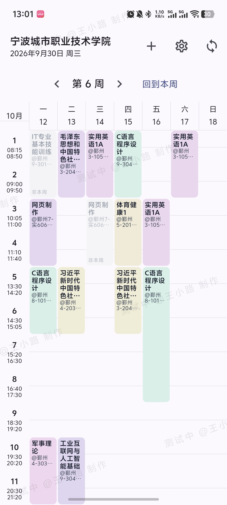
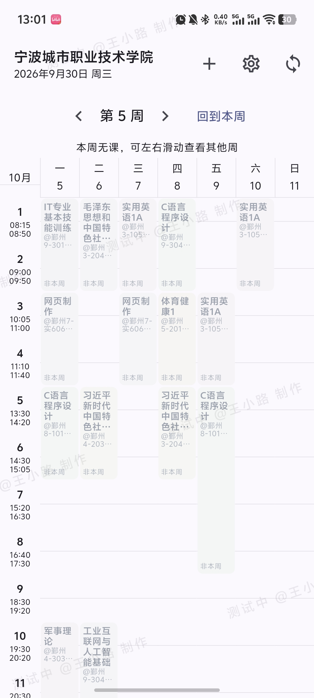

# 课表 · Class Schedule

一个 Android 课表 App：登录学校教务系统，整学期课表自动抓回手机。不用手抄、不用截图、不用记周次。

不需要账号，数据只存在手机本地，App 也不连任何第三方服务器。

> 只想装来用？到 [Releases](https://github.com/Wangxiaolu0716/class-schedule/releases) 下最新的 `.apk` 即可。
> 想自己改、或把自己学校加进来，继续往下看。

## 截图

<table>
<tr>
<td align="center"><br>
<sub>有课的一周：本周实色，非本周淡显并标注</sub></td>
<td align="center"><br>
<sub>没课的一周：整屏淡显，但每门课的位置都还在</sub></td>
</tr>
</table>

## 功能

**导入课表**

- 内置 2892 所院校的教务入口和两套解析器（正方 EAMS / 正方 jwglxt），选学校 → 登录 → 自动抓课表
- 本校（宁波城市职业技术学院）走全自动：登录后自己定位课表接口
- 其它学校走手动导课：自己在页面里翻到课表页，再点一下抓取
- 认不出来的系统可以用 **AI 识别导入**：把课表截图交给 AI，粘回 JSON
- 完全不用教务系统也行，全部手输

**看课表**

- 周视图：左侧节次与钟点，顶部周次与日期条，左右滑动换周；点「第 N 周」可直接跳
- 本周实色、非本周淡显并标注，某周没课时整张课表的形状依然完整
- 点色块看教师、教室、节次时间、周次
- 同一时段「二选一」的课（双周/某几周）合并显示，真正冲突才分列
- 调休：某天按别的星期的课表上

**自己加课**

- 课程：多时段、自选颜色、周次节次、自定义时间、教室、老师、备注
- 日程：全天、重复（永不 / 每天 / 每周）、标签
- 自建条目与导入的课表分开存储，重新导入不会冲掉

**外观**

- 7 套样式预设：经典 / 纸感 / 莫兰迪 / 水墨 / 玻璃感 / 糖果 / 午夜，连设置页和弹窗一起换色
- 自定义背景图，透明度、模糊、压暗可调，卡片不透明度另有一档
- 白天 / 夜晚 / 跟随系统；可导入自定义字体
- 水印默认关闭，三指轻敲三次进隐藏页可开关、可改文案

**通知与设置**

- 课前 15 分钟通知，自建课程与日程一并纳入
- 打开课表时静默刷新教务（默认关，只请求你自己学校），登录态缓存在本机，可一键清除
- 开学时间（不知道就按「今天是第几周」反推）、上课时间、每周起始日、学期周数、每天几节
- 格子高度、圆角、是否显示周末、是否显示非本周课程、底部预留空档

另外内置**解析诊断**页：把课表页 HTML 交给解析器跑一遍，看是哪个解析器认出来的、切出多少段排课。

## 这个版本不包含什么

- 没有检查更新、公告、赞助名单、作者二维码、教程视频——这些依赖作者自己的服务器，已全部移除
- 不请求作者的任何服务器。会联网的地方只有两处：打开你自己学校的教务系统页面；以及你手动开启自动刷新后，请求那所学校自己的课表接口

## 它是怎么工作的

教务系统的课表页对外的形状很固定：一个 `TaskActivity` 数组，`index = 星期 × 每天节数 + 节次`，周次是位图。解析器只认这个形状，与具体学校无关；因校而异的只有「从哪登录、课表页和接口路径是什么、第一周从哪天算起」，这些放在 `lib/import/school_config.dart`。

- 本校 EAMS 走 WebVPN，页面依赖的框架脚本加载失败，所以不用它自己的 `searchTable()`，而是注入原生 `fetch` 自己请求课表接口
- 别的 jwglxt 学校不猜接口路径：用户已经把页面翻到课表页了，直接读渲染后的 DOM
- 缓存的是**原始 HTML**而不是解析结果：以后修了解析器，重新解析缓存就能生效，不会出现旧数据格式不兼容

## 目录结构

```
lib/
├── main.dart                    入口：主题、字体、水印、隐藏手势
├── import/                      学校配置、内置院校清单、导入页、登录态缓存
│   ├── school_service.dart      内置院校列表（不联网）
│   ├── school_session.dart      教务登录态（Cookie）缓存
│   └── silent_refresh.dart      打开时静默刷新
├── parsers/                     解析器：EAMS / jwglxt / AI JSON / 诊断
├── models/                      课表数据、自建条目、分列合并、配置
├── screens/                     课表页、设置页、外观页、编辑器
├── theme/                       主题模式、字体、样式预设与背景
├── reminder/                    课前通知
└── watermark/                   水印（默认关闭）
test/                            单测与各系统课表页样本
```

## 本地构建

需要 Flutter（Dart SDK `^3.13.4`）。

```bash
flutter pub get
flutter analyze     # 应当零问题
flutter test        # 应当全部通过
flutter build apk --release --target-platform android-arm64
```

产物在 `build/app/outputs/flutter-apk/app-release.apk`。只打 `arm64-v8a` 能省约 35 MB；要兼容 32 位老机型就加 `android-arm,android-arm64,android-x64`。

## 加一所学校

改 `lib/import/school_service.dart` 里的内置列表，加一条：

```dart
SchoolInfo(name: '某某大学', url: 'https://jw.example.edu.cn/'),
```

`url` 填教务系统入口（登录页或统一身份认证页）。没验证过能不能真导出课表就别加 `verified: true`——界面会把未验证的如实标出来。

验证过的学校，可以进一步在 `school_config.dart` 里加一份自动导入配置（课表页地址 + 接口路径 + 开学日期），这样用户登录后能自动抓。

## 加一套新解析器

解析器只需要产出 `CourseTableData`：`sessions`（每条含课名、教师、教室、星期、节次、周次）+ `courses`。写好后在 `parsers/course_table_parser.dart` 的调度里挂上，导入时会挨个试。

调试用「解析诊断」页：它会把每个解析器的结果都跑一遍并给出报告，比截图猜快得多。

## 测试

```bash
flutter test
```

`test/fixtures/` 里放着脱敏后的真实课表页样本，解析器的回归测试都跑在这些样本上。

## 许可

[PolyForm Noncommercial License 1.0.0](LICENSE)：可以自由阅读、修改、自用，不能商用。
